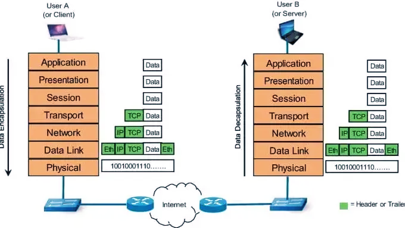

------------------------------------------------------------------------------------------------------
🎯 Découvrir les réseaux par la pratique (adressage IP, OSI, DHCP, NAT)
------------------------------------------------------------------------------------------------------
Cet atelier vous fait découvrir **comment les ordinateurs communiquent**, en manipulant un vrai petit
réseau. Aucune connaissance préalable en réseau n'est nécessaire : les exercices sont progressifs.

Vous travaillerez avec **deux outils complémentaires** :

| Outil | Rôle | Ce que vous y faites |
| ----- | ---- | -------------------- |
| 📖 **PythonAnywhere** | Le **cours** | Vous hébergez un site qui contient les fiches théoriques (IP, OSI, DHCP, NAT). Vous les lisez **avant** chaque exercice. |
| 💻 **GitHub Codespaces** | Le **laboratoire** | Un ordinateur Linux dans votre navigateur, dans lequel tourne un mini-réseau de 4 machines. Vous y réalisez les exercices. |

**Notre architecture cible**



**Comment travailler, pour chaque exercice :**

1. 📖 Lisez la **fiche théorique** sur votre site PythonAnywhere.
2. 💻 Réalisez l'**exercice** dans votre Codespace, étape par étape.
3. ✍️ Écrivez vos **réponses directement dans le fichier de l'exercice** (zones « 💬 Votre réponse »).
4. 💾 **Sauvegardez** votre travail sur GitHub (commit + push, voir la section en bas de page).

-------------------------------------------------------------------------------------------------------
🧩 Séquence 1 : Créer votre dépôt à partir du modèle
-------------------------------------------------------------------------------------------------------
Objectif : obtenir votre propre copie de l'atelier sur GitHub.
Difficulté : Très facile (~5 minutes)
-------------------------------------------------------------------------------------------------------

Ce dépôt est un **modèle** (*template*). Vous allez créer **votre propre dépôt** à partir de lui :

1. Connectez-vous à votre compte GitHub (créez-en un gratuitement si besoin sur https://github.com).
2. En haut de cette page, cliquez sur le bouton vert **Use this template** → **Create a new repository**.
3. Choisissez :
   * **Owner** : votre compte ;
   * **Repository name** : par exemple `atelier-reseau` ;
   * Visibilité : **Public** (ou *Private* si votre enseignant le demande).
4. Cliquez sur **Create repository**.

✅ Vous êtes maintenant sur **votre** dépôt (son adresse contient votre nom d'utilisateur).
Toutes les séquences suivantes se font **depuis votre dépôt**, pas depuis le modèle.

> 💡 *Pourquoi un template plutôt qu'un fork ?* Votre dépôt est indépendant : il n'est pas relié au
> modèle, ses GitHub Actions sont actives d'emblée et votre travail reste bien séparé de celui des autres.

-------------------------------------------------------------------------------------------------------
🧩 Séquence 2 : Ouvrir votre laboratoire dans Codespaces
-------------------------------------------------------------------------------------------------------
Objectif : lancer l'ordinateur en ligne dans lequel vous ferez les exercices.
Difficulté : Très facile (~10 minutes, dont 5 d'attente)
-------------------------------------------------------------------------------------------------------

1. Sur **votre** dépôt, cliquez sur le bouton vert **Code** → onglet **Codespaces** →
   **Create codespace on main**.
2. Un éditeur (Visual Studio Code) s'ouvre dans votre navigateur. **Lors de la toute première ouverture,
   patientez 3 à 5 minutes** : Docker s'installe et le mini-réseau se construit automatiquement
   (vous pouvez suivre l'avancement dans le terminal en bas).
3. Quand c'est terminé, réalisez l'**[exercice 0 — Prise en main](lab/exercises/00_prise_en_main.md)** :
   il vous apprend à ouvrir un terminal, démarrer le lab et entrer dans les machines.

> 💡 Pour **retrouver** votre Codespace plus tard : bouton **Code** → **Codespaces** → cliquez sur son nom.
> Pensez à l'**arrêter** quand vous avez fini (menu ☰ en haut à gauche → *Codespaces: Stop Current Codespace*) :
> votre quota gratuit mensuel est limité.

---------------------------------------------------
🧩 Séquence 3 : Héberger le cours sur PythonAnywhere
---------------------------------------------------
Objectif : mettre en ligne le site qui contient les fiches théoriques.
Difficulté : Faible (~10 minutes)
---------------------------------------------------

> ⚠️ **Ne traduisez pas le site PythonAnywhere en français.** Si votre navigateur propose
> « Traduire cette page », refusez (ou choisissez *Ne jamais traduire ce site*). La traduction
> automatique renomme les menus et les boutons (*Web*, *Files*, *Account*, *API Token*…) : vous ne
> les retrouveriez plus tels qu'ils sont cités dans cet atelier, et elle peut aussi modifier les
> chemins et noms que vous recopiez.

Rendez-vous sur **https://www.pythonanywhere.com/**, créez un compte gratuit (*Beginner*), puis dans
l'onglet **Web** créez une application Web **Flask** avec la dernière version de Python proposée.

Notez l'adresse de votre site :
* compte créé sur **www.pythonanywhere.com** (US) → `https://<votre-site>.pythonanywhere.com` ;
* compte créé sur **eu.pythonanywhere.com** (Europe) → `https://<votre-site>.eu.pythonanywhere.com`.

Dans les énoncés, remplacez `<votre-site>` par votre nom d'utilisateur PythonAnywhere (et ajoutez
`.eu` dans l'adresse si votre compte est européen).

---------------------------------------------------------------------------------------------
🧩 Séquence 4 : GitHub Actions (déploiement automatique)
---------------------------------------------------------------------------------------------
Objectif : publier automatiquement le cours sur PythonAnywhere à chaque modification de votre dépôt.
Difficulté : Moyenne (~15 minutes)
---------------------------------------------------------------------------------------------
Le workflow `.github/workflows/deploy-pythonanywhere.yml` envoie le code de votre dépôt vers
PythonAnywhere à chaque *push* sur `main`. Tant que les secrets ci-dessous ne sont pas créés, il
s'arrête simplement avec un avertissement.

**Créez les secrets** dans votre dépôt : **Settings → Secrets and variables → Actions → New repository secret**.
Les 4 premiers sont obligatoires ; le 5ᵉ (`PA_HOST`) est **obligatoire pour les comptes européens**.

| Secret              | Valeur                                                   |
| ------------------- | -------------------------------------------------------- |
| `PA_USERNAME`       | votre nom d'utilisateur PythonAnywhere                   |
| `PA_TOKEN`          | votre jeton d'API (PythonAnywhere : Account → API Token) |
| `PA_TARGET_DIR`     | onglet Web → *Source code* (ex. : `/home/monuser/mysite`) |
| `PA_WEBAPP_DOMAIN`  | votre site, **sans** `https://` (ex. : `monuser.pythonanywhere.com` ou `monuser.eu.pythonanywhere.com`) |
| `PA_HOST`           | **comptes européens uniquement** : `eu.pythonanywhere.com` (inutile pour un compte US) |

**Lancez le déploiement** : onglet **Actions** → *Deploy to PythonAnywhere* → **Run workflow**.
Quand la coche est verte, ouvrez `https://<votre-site>.pythonanywhere.com` : la page d'accueil de
l'atelier doit s'afficher.

> 💡 Erreur `401` ou `404` dans les logs de l'action ? Vérifiez d'abord `PA_HOST` : sans lui, le
> workflow contacte le serveur US, qui ne connaît pas les comptes européens.

---------------------------------------------------
🗺️ Séquence 5 : Adresses IP, adresses MAC et ping
---------------------------------------------------
Difficulté : ⭐ Facile (~45 min)
---------------------------------------------------

📖 **Théorie** — fiche **`https://<votre-site>.pythonanywhere.com/bases`** : adresse IP, masque,
passerelle, adresse MAC, ARP, ping, TTL.

💻 **Pratique** — **[exercice 1](lab/exercises/01_ip_mac_ping.md)** : depuis le poste client, trouvez
vos adresses, votre passerelle, observez ARP et suivez le chemin jusqu'au serveur web.

---------------------------------------------------
🗺️ Séquence 6 : Le modèle OSI
---------------------------------------------------
Difficulté : ⭐⭐ Moyenne (~1 h)
---------------------------------------------------

📖 **Théorie** — fiche **`https://<votre-site>.pythonanywhere.com/osi`** : les 7 couches, l'encapsulation
et le vocabulaire (protocole, service, PDU, SDU…).

💻 **Pratique** — **[exercice 2](lab/exercises/02_osi_capture.md)** : enregistrez une visite web avec
`tcpdump`, puis décortiquez chaque paquet couche par couche avec le script `osi_inspect.py`.

---------------------------------------------------
🗺️ Séquence 7 : Le protocole DHCP
---------------------------------------------------
Difficulté : ⭐⭐ Moyenne (~1 h)
---------------------------------------------------

📖 **Théorie** — fiche **`https://<votre-site>.pythonanywhere.com/dhcp`** : l'échange DORA et les options DHCP.

💻 **Pratique** — **[exercice 3](lab/exercises/03_dhcp_dora.md)** : retirez l'adresse IP du client,
capturez les 4 messages DHCP pendant qu'il en redemande une, et retrouvez la configuration reçue.

---------------------------------------------------
🗺️ Séquence 8 : NAT / PAT
---------------------------------------------------
Difficulté : ⭐⭐⭐ Plus difficile (~1 h)
---------------------------------------------------

📖 **Théorie** — fiche **`https://<votre-site>.pythonanywhere.com/nat`** : adresses privées, traduction
d'adresses et de ports.

💻 **Pratique** — **[exercice 4](lab/exercises/04_nat_pat.md)** : lisez la table de traduction du routeur,
supprimez la règle NAT pour provoquer une panne, puis réparez-la.

---------------------------------------------------
🗺️ Séquence 9 (Bonus) : Un faux serveur DHCP
---------------------------------------------------
Difficulté : ⭐⭐⭐ Plus difficile (~45 min)
---------------------------------------------------

💻 **Pratique** — **[exercice 5 (bonus)](lab/exercises/05_rogue_dhcp_bonus.md)** : un attaquant installe
un faux serveur DHCP dans le lab. Observez comment il détourne le client, puis détectez-le avec un script.

---------------------------------------------------
🗺️ Séquence 10 : Mesurer la qualité de service (QoS)
---------------------------------------------------
Difficulté : ⭐⭐ Moyenne (~20 min)
---------------------------------------------------

📖 **Théorie** — page **`https://<votre-site>.pythonanywhere.com/metrics`** : temps de réponse (latence),
débit, taux d'erreur, et limitation du nombre de requêtes (*token bucket*).

💻 **Pratique** — dans le **terminal Codespace** 🖥️, remplacez `<votre-site>` puis :

**Étape 1** — envoyez 30 requêtes à votre site, puis lisez les mesures :

```bash
SITE=https://<votre-site>.pythonanywhere.com
for i in $(seq 1 30); do curl -s -o /dev/null $SITE/osi; done
curl -s $SITE/metrics | python -m json.tool
```

**Étape 2** — interrogez `/metrics` 20 fois **en même temps** (le `&` lance les requêtes en parallèle)
et comptez les codes de réponse HTTP :

```bash
for i in $(seq 1 20); do curl -s -o /dev/null -w "%{http_code}\n" $SITE/metrics & done | sort | uniq -c
```

**Questions** (répondez ici) :

* Dans le résultat de l'étape 1, que représentent `p50` et `p99` ? Pourquoi `p99` est-il plus grand que `p50` ?

  > 💬 **Votre réponse :** _…_

* À l'étape 2, combien de réponses `200` et combien de `429` obtenez-vous ? Que signifie le code `429` ?
  Retrouvez le nombre de `200` dans le paramètre `burst` affiché à l'étape 1.
  Pourquoi n'obtient-on pas de `429` si l'on envoie les requêtes **l'une après l'autre** ?
  (Indice : regardez `tokens_per_sec`.)

  > 💬 **Votre réponse :** _…_

--------------------------------------------------------------------
💾 Sauvegarder votre travail
--------------------------------------------------------------------

Vos réponses sont écrites dans les fichiers de votre Codespace. Pour les **envoyer sur GitHub** :

* **Avec la souris** : icône **Source Control** (3ᵉ icône de la barre de gauche) → tapez un message
  (ex. « Exercice 1 terminé ») → **Commit** → **Sync Changes**.
* **Ou dans le terminal Codespace** 🖥️ :

  ```bash
  git add -A
  git commit -m "Exercice 1 terminé"
  git push
  ```

> 💡 Chaque *push* relance aussi le déploiement sur PythonAnywhere (séquence 4).

--------------------------------------------------------------------
🧠 En cas de problème
---------------------------------------------------

**Côté Codespace (le lab)** — dans le terminal Codespace 🖥️, dossier `lab` :

```bash
docker compose ps                              # les 4 machines sont-elles « Up » ?
docker compose up -d                           # (re)démarrer le lab
docker compose down && docker compose up -d    # tout remettre à zéro
bash host-setup.sh                             # si le client n'arrive plus à joindre 172.20.0.10
```

Chaque énoncé se termine par un tableau **🆘 En cas de problème**. Le fonctionnement du lab est détaillé
dans [`lab/README.md`](lab/README.md).

**Côté PythonAnywhere (le cours)** — onglet **Web**, section *Log files* :
* Access log : `<votre-site>.pythonanywhere.com.access.log` (requêtes reçues)
* Error log : `<votre-site>.pythonanywhere.com.error.log` (erreurs Python)
* Server log : `<votre-site>.pythonanywhere.com.server.log` (démarrage du serveur)
