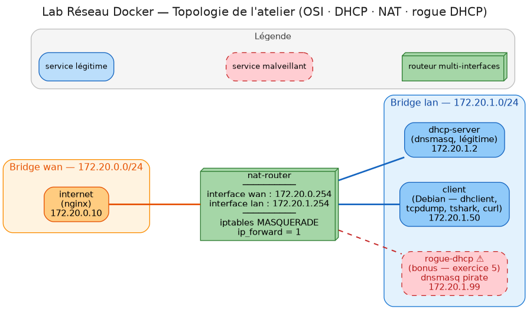

# Lab Réseau — un mini-réseau dans votre Codespace

Ce dossier contient un **vrai petit réseau** de 4 machines (des conteneurs Docker), qui tourne
directement dans votre GitHub Codespace. Vous y capturez de vrais paquets (`tcpdump`, `tshark`),
vous observez DHCP en action et vous manipulez le NAT du routeur (`iptables`, `conntrack`).

## Topologie



<details>
<summary>Variante texte</summary>

```
                  ┌──────────────────┐
                  │   internet       │  172.20.0.10
                  │   (nginx)        │
                  └────────┬─────────┘
                           │  WAN : 172.20.0.0/24
                  ┌────────┴─────────┐
                  │   nat-router     │  wan = 172.20.0.254
                  │  iptables NAT    │  lan = 172.20.1.254
                  └────────┬─────────┘
                           │  LAN : 172.20.1.0/24
        ┌──────────────────┼───────────────────┐
        │                  │                   │
┌───────┴────────┐ ┌───────┴──────────┐ ┌──────┴────────┐
│  dhcp-server   │ │      client      │ │  rogue-dhcp ⚠ │
│  172.20.1.2    │ │   172.20.1.50    │ │  172.20.1.99  │
│  (dnsmasq)     │ │ (dhclient/tshark)│ │ (bonus ex. 5) │
└────────────────┘ └──────────────────┘ └───────────────┘
```

</details>

| Conteneur      | Rôle                                                   | Comment y entrer                       |
| -------------- | ------------------------------------------------------ | -------------------------------------- |
| `client`       | Le poste utilisateur (Debian)                          | `docker exec -it lab_client bash`      |
| `nat-router`   | La « box » : routage + NAT. Interfaces `lan` et `wan`  | `docker exec -it lab_nat_router bash`  |
| `dhcp-server`  | Distribue les adresses IP (dnsmasq)                    | `docker exec -it lab_dhcp_server sh`   |
| `internet`     | Site web « public » qui affiche l'IP qu'il voit (nginx) | — (on lit son journal : `docker logs lab_internet`) |
| `rogue-dhcp` ⚠ | Faux serveur DHCP, **exercice 5 uniquement**           | démarré avec `--profile bonus`         |

## Exercices (à faire dans l'ordre)

| #  | Énoncé | Sujet | Niveau | Fiche théorique |
| -- | ------ | ----- | ------ | --------------- |
| 0  | [00_prise_en_main.md](exercises/00_prise_en_main.md) | Codespace, terminal, démarrer le lab | ⭐ | — |
| 1  | [01_ip_mac_ping.md](exercises/01_ip_mac_ping.md) | Adresses IP et MAC, passerelle, ARP, ping | ⭐ | `/bases` |
| 2  | [02_osi_capture.md](exercises/02_osi_capture.md) | Capturer une visite web, lire les couches OSI | ⭐⭐ | `/osi` |
| 3  | [03_dhcp_dora.md](exercises/03_dhcp_dora.md) | Obtenir une IP par DHCP (Discover/Offer/Request/ACK) | ⭐⭐ | `/dhcp` |
| 4  | [04_nat_pat.md](exercises/04_nat_pat.md) | NAT/PAT : table de traduction, casser et réparer | ⭐⭐⭐ | `/nat` |
| 5  | [05_rogue_dhcp_bonus.md](exercises/05_rogue_dhcp_bonus.md) | **Bonus** : faux serveur DHCP et détection | ⭐⭐⭐ | `/dhcp` |

## Commandes utiles (terminal Codespace, dossier `lab`)

```bash
docker compose up -d                       # démarrer le lab
docker compose ps                          # état des machines
docker compose restart client              # remettre le client à zéro (IP 172.20.1.50)
docker compose restart nat-router          # remettre les règles NAT d'origine
docker compose down && docker compose up -d   # tout remettre à zéro
docker logs -f lab_dhcp_server             # journal DHCP en direct (Ctrl+C pour quitter)
docker logs --tail 5 lab_internet          # dernières requêtes reçues par le serveur web
docker compose down                        # arrêter le lab
```

## Comment le lab est préparé dans Codespace

Tout est automatique grâce au fichier [`.devcontainer/devcontainer.json`](../.devcontainer/devcontainer.json) :

- **À la création du Codespace** : Docker est installé et les images du lab sont construites
  (`docker compose build`, environ 3 minutes).
- **À chaque démarrage du Codespace** : le script [`host-setup.sh`](host-setup.sh) est exécuté.

<details>
<summary>Pourquoi <code>host-setup.sh</code> ? (détail technique)</summary>

Par défaut, le noyau Linux fait passer le trafic des réseaux Docker par le pare-feu (`iptables`) de
la machine hôte (mécanisme `br_netfilter`). Ce pare-feu bloquerait le trafic entre nos réseaux `lan`
et `wan`. Le script désactive ce mécanisme pour que ce soit bien **le conteneur `nat-router`** qui
route et fasse le NAT — c'est lui que l'on veut observer. Si `curl` vers `172.20.0.10` ne répond pas,
relancez-le : `bash lab/host-setup.sh`.

</details>

<details>
<summary>Utiliser le lab ailleurs que dans Codespace (Linux avec Docker)</summary>

```bash
cd lab
sudo ./host-setup.sh        # une fois par démarrage de la machine
docker compose build
docker compose up -d
```

</details>
