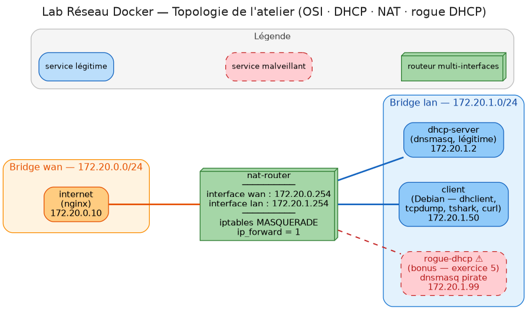

# Exercice 0 — Prise en main de Codespace et du lab

**Niveau :** ⭐ (découverte) · **Durée :** ~20 min
**📖 Fiche théorique :** aucune pour cet exercice — on découvre l'outil.

## 🎯 Objectifs

- Savoir ouvrir un terminal dans Codespace et y taper des commandes.
- Démarrer le mini-réseau du lab.
- Savoir « entrer » dans une machine du lab et en ressortir.

> ⚠️ **Ne traduisez pas le site PythonAnywhere en français.** Si votre navigateur propose
> « Traduire cette page », refusez (ou choisissez *Ne jamais traduire ce site*). La traduction
> automatique renomme les menus et les boutons (*Web*, *Files*, *Account*, *API Token*…) : vous ne
> les retrouveriez plus tels qu'ils sont cités dans cet atelier, et elle peut aussi modifier les
> chemins et noms que vous recopiez.

---

## Le principe du lab

Votre Codespace est un ordinateur Linux dans le cloud. À l'intérieur, on fait tourner
**4 petites machines virtuelles** (des *conteneurs* Docker) reliées entre elles comme dans un vrai réseau :



| Machine       | Adresse IP                      | Rôle                                        |
| ------------- | ------------------------------- | ------------------------------------------- |
| `client`      | `172.20.1.50`                   | Le poste de l'utilisateur (votre « PC »)    |
| `dhcp-server` | `172.20.1.2`                    | Distribue les adresses IP automatiquement   |
| `nat-router`  | `172.20.1.254` / `172.20.0.254` | La « box » : relie le réseau local à Internet |
| `internet`    | `172.20.0.10`                   | Un site web qui joue le rôle d'Internet     |

Le réseau `172.20.1.0/24` est le **LAN** (réseau local, comme chez vous).
Le réseau `172.20.0.0/24` est le **WAN** (il joue le rôle d'Internet).

## Les terminaux utilisés dans les exercices

Chaque commande des énoncés indique **où** la taper grâce à un symbole :

| Symbole | Où taper la commande          | À quoi ressemble l'invite (*prompt*)          |
| ------- | ----------------------------- | --------------------------------------------- |
| 🖥️      | Terminal **Codespace**        | `@votre-nom ➜ /workspaces/ATELIER_RESEAU (main) $` |
| 💻      | Terminal **du client**        | `root@client:/#`                              |
| 🔀      | Terminal **du routeur**       | `nat-router:/#`                               |
| 🗄️      | Terminal **du serveur DHCP**  | `/ #`                                         |

> 💡 **Regardez toujours l'invite avant de taper une commande.** C'est la source d'erreur n°1 :
> une commande tapée dans le mauvais terminal ne fera pas ce que vous attendez.

---

## Étape 1 — Ouvrir un terminal

Dans Codespace, ouvrez le menu ☰ → **Terminal → New Terminal** (ou le raccourci <kbd>Ctrl</kbd>+<kbd>`</kbd>).
Un terminal 🖥️ s'ouvre en bas de l'écran.

🖥️ Tapez votre première commande :

```bash
pwd
```

👀 Vous devez voir `/workspaces/ATELIER_RESEAU` (ou le nom de votre dépôt) : c'est le dossier où vous vous trouvez.

## Étape 2 — Démarrer le lab

🖥️ Placez-vous dans le dossier du lab et démarrez les 4 machines :

```bash
cd lab
docker compose up -d
```

> ⏳ Les images ont normalement déjà été construites à la création du Codespace.
> Si ce n'est pas le cas, la première fois peut prendre 2 à 3 minutes.

🖥️ Vérifiez que les 4 machines sont démarrées :

```bash
docker compose ps
```

👀 Vous devez voir 4 lignes (`lab_client`, `lab_dhcp_server`, `lab_internet`, `lab_nat_router`)
avec le statut **Up**.

## Étape 3 — Entrer dans le poste client

🖥️ Ouvrez un terminal *à l'intérieur* de la machine `client` :

```bash
docker exec -it lab_client bash
```

👀 L'invite change et devient `root@client:/#`. Vous êtes maintenant **sur le poste client** 💻.

💻 Vérifiez-le :

```bash
hostname
```

💻 Puis ressortez de la machine :

```bash
exit
```

👀 Vous êtes revenu dans le terminal Codespace 🖥️.

## Étape 4 — Travailler avec plusieurs terminaux

Certains exercices demandent **deux terminaux en même temps** (un qui écoute le réseau, un qui
envoie du trafic). Dans Codespace, cliquez sur l'icône **➕** (ou **⊟ Split**) en haut à droite
du panneau Terminal pour en ouvrir un second.

🖥️ Dans le **premier** terminal, entrez dans le routeur :

```bash
docker exec -it lab_nat_router bash
```

🖥️ Dans le **second** terminal, entrez dans le client :

```bash
docker exec -it lab_client bash
```

💻 Depuis le client, envoyez une requête au site web « Internet » :

```bash
curl http://172.20.0.10/whoami
```

👀 Vous devez voir : `Your perceived source IP (post-NAT) is: 172.20.0.254`.
Retenez ce résultat, il sera expliqué dans l'exercice 4 !

## ❓ Questions

**Question 1.** Quelle commande permet de voir si les machines du lab sont démarrées ?

> 💬 **Votre réponse :**
>
> _Remplacez ce texte par votre réponse._

**Question 2.** Comment savez-vous, en regardant l'écran, que vous êtes dans le terminal du client et non dans celui de Codespace ?

> 💬 **Votre réponse :**
>
> _Remplacez ce texte par votre réponse._

**Question 3.** Le client a l'adresse `172.20.1.50` et le site web `172.20.0.10`. Ces deux machines sont-elles sur le même réseau ? Quelle machine se trouve « entre » les deux ?

> 💬 **Votre réponse :**
>
> _Remplacez ce texte par votre réponse._

---

## ✅ Ce qu'il faut retenir

- `docker compose up -d` démarre le lab, `docker compose ps` affiche son état.
- `docker exec -it <machine> bash` ouvre un terminal dans une machine, `exit` en ressort.
- Toujours vérifier l'invite pour savoir **sur quelle machine** on tape.

## 🆘 En cas de problème

| Problème | Solution |
| -------- | -------- |
| `no configuration file provided` | Vous n'êtes pas dans le dossier `lab`. Tapez `cd /workspaces/*/lab` |
| Une machine n'est pas **Up** | 🖥️ `docker compose up -d` à nouveau |
| Le lab semble « cassé » après vos manipulations | 🖥️ `docker compose down && docker compose up -d` remet tout à zéro |
| `curl` ne répond pas (timeout) | 🖥️ `bash host-setup.sh` puis réessayez (voir [`lab/README.md`](../README.md)) |
